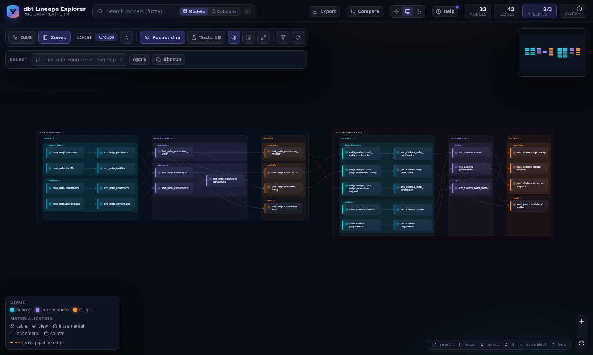
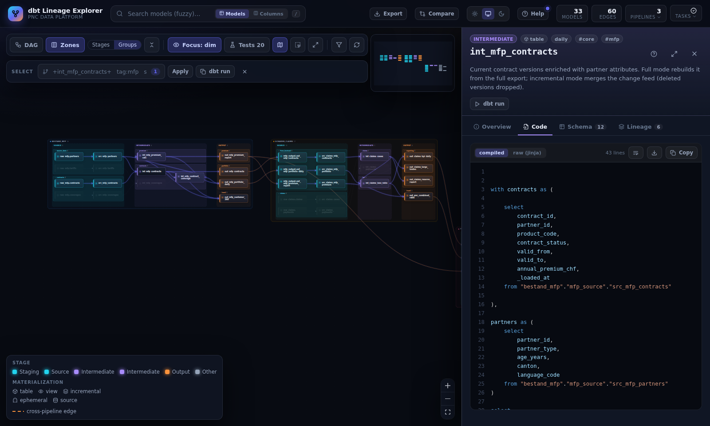
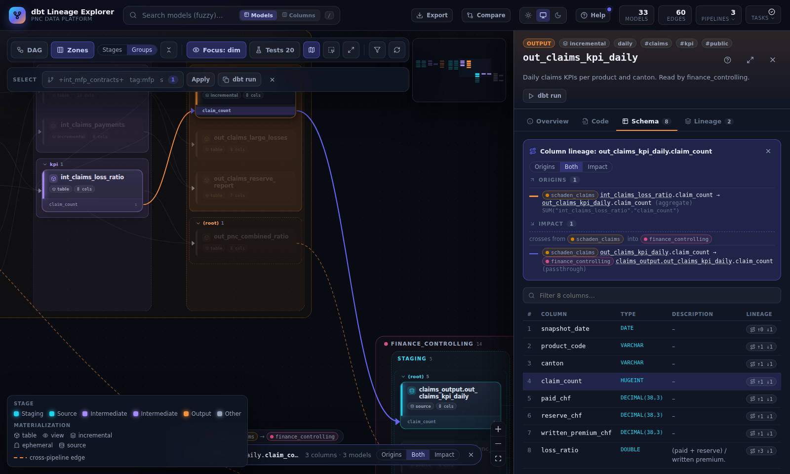
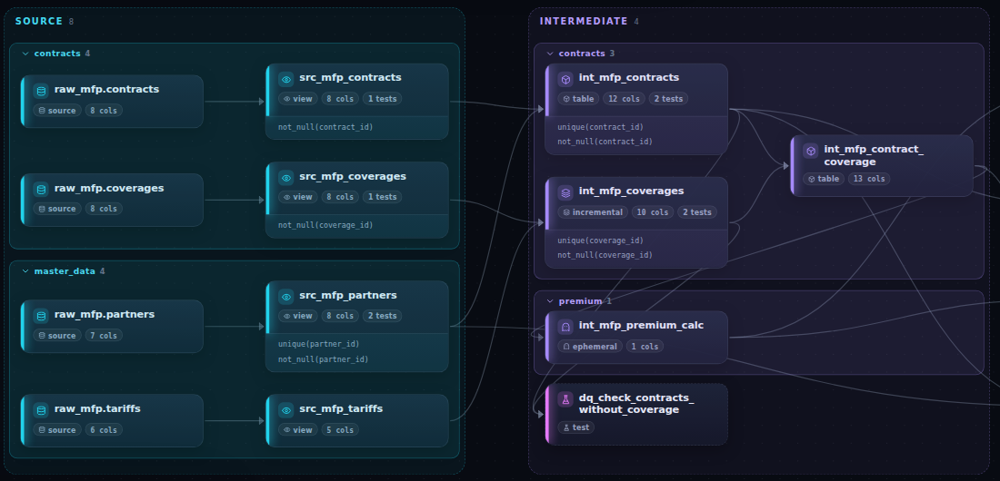
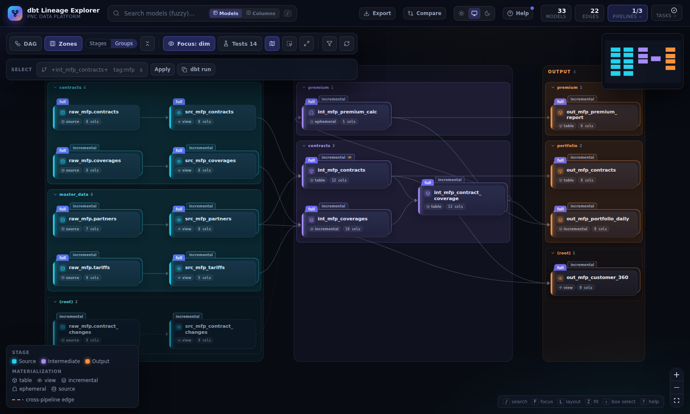
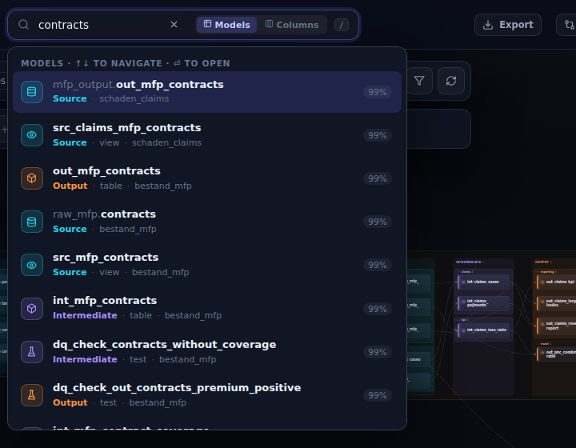

# dbt Lineage Explorer

An interactive lineage explorer for dbt. It reads the `manifest.json` and `catalog.json` of one
or more dbt projects ("pipelines"), stitches them together and draws the result as a graph. You
can open any model to see its SQL, columns and dependencies, trace a single column through
every pipeline, and see the dbt tests and data quality checks attached to each model.



- [Features](#features)
- [Requirements](#requirements)
- [Start the application](#start-the-application)
- [Running on a VM: SSH port forwarding](#running-on-a-vm-ssh-port-forwarding)
- [Configure your pipelines: `pipelines.yaml`](#configure-your-pipelines-pipelinesyaml)
- [Settings](#settings)
- [Development](#development)

---

## Features

### Graph of all pipelines

The **Zones** view draws every pipeline in its own box: its layers (for example source →
intermediate → output) as columns, and the model sub-folders as collapsible boxes inside them.
Pipelines that read each other's outputs are linked across boxes (dashed orange edges). **DAG**
switches to a plain left-to-right graph.

### Model details

Click a model to open its details: description, compiled and raw SQL, columns with types,
dependencies and dependents, the dbt tests on it, a BigQuery link and a copyable `dbt run`
command.



### Column lineage

In the **Schema** tab, the ↑↓ button on a column traces it upstream and downstream, across
pipelines. The traced columns appear as rows inside the cards. The edges are coloured by what
happens to the value (passthrough, rename, transform, aggregate), and the panel lists every
hop with its SQL expression.



### dbt tests and data quality checks

**Tests** in the toolbar lists each model's yaml tests (`unique(contract_id)`,
`not_null(…)`) inside its card. Singular tests (`.sql` files under `tests/`, such as
`dq_check_*`) appear as dashed nodes under the models they check.



### Execution modes

A pipeline can have several **execution modes**: dbt vars that change what is built, such as
a full and an incremental load. Pick a mode in the **pipelines** menu, or stack several modes
to compare them. Each card then gets a tab per mode, and models that exist in only one mode
are drawn dashed. The ↻ button on each mode reruns `dbt docs generate` for it.



### Search

Press `/` and type to search, typo tolerant. Switch to **Columns** to search column names
across all models.



### More

| | |
|---|---|
| **Focus** (`F`) | dim or hide everything outside the selected model's lineage |
| **Select** | dbt selector syntax: `+int_mfp_contracts+`, `tag:mfp`, `2+out_claims_kpi_daily`; copy the matching `dbt run --select` |
| **Compare** | upload a dev `manifest.json` and see what was added, changed or removed, down to the SQL diff |
| **Export** | PNG, SVG or Mermaid of what the canvas shows, for documentation |
| **Help** | a guided tour of the interface |
| **Share** | the URL keeps the open model, tab, layout, focus and selection |
| **Themes** | light, dark, or follow the system |

Keyboard: `/` search · `F` focus · `L` layout · `Z` zoom to fit · `M` mini-map ·
`Shift`+drag box select · `?` help.

---

## Requirements

| | Version | Needed for |
|---|---|---|
| [uv](https://docs.astral.sh/uv/) | recent | the backend (it installs Python and the dependencies) |
| Python | 3.11 or newer (3.11–3.13 for the bundled dbt examples) | the backend, installed by uv if missing |
| Node.js | 18 or newer (20 recommended), with npm | the frontend |
| dbt-core | 1.8 or newer, with your adapter | only for generating artifacts from the app (`project_dir` in `pipelines.yaml`) |
| Browser | a current Chrome, Edge or Firefox | |

Ports: the backend uses **8000**, the frontend **5173**.

---

## Start the application

```bash
git clone https://github.com/rm00cr/dbt_lineage_graph.git
cd dbt_lineage_graph

./dev.sh examples/pipelines.yaml   # three bundled dbt projects, built by the app itself
./dev.sh path/to/pipelines.yaml    # your own pipelines (see below)
./dev.sh                           # small synthetic fixtures, no dbt needed
```

Then open **http://localhost:5173**. `dev.sh` starts the backend and the frontend together,
installs the frontend dependencies on the first run, and stops both with `Ctrl+C`.

With the examples, the first start takes a moment: the backend runs `dbt docs generate` for
each pipeline in the background. Watch the task indicator in the top bar.

To start the two parts separately:

```bash
cd back-end  && uv run lineage-api --config ../examples/pipelines.yaml --reload   # :8000, API docs at /docs
cd front-end && npm install && npm run dev                                       # :5173
```

The frontend forwards every `/api` request to the backend on port 8000. If it cannot reach the
backend, it shows bundled demo data instead.

---

## Running on a VM: SSH port forwarding

When the application runs on a remote VM, forward **both ports** to your machine:

- **5173**: the frontend, which you open in the browser.
- **8000**: the backend, for its API docs (`/docs`) and for direct API calls.

The frontend reaches the API through 5173, but forwarding 8000 as well keeps the backend
reachable when port 5173 has trouble. If the frontend cannot reach the API at all, it quietly
shows demo data, so a missing forward is easy to overlook.

Add this to `~/.ssh/config` on **your own machine**:

```
Host lineage-vm
    HostName <vm-host-or-ip>
    User <your-user>
    LocalForward 5173 localhost:5173
    LocalForward 8000 localhost:8000
    # fail loudly if a port is already taken locally, instead of connecting without it
    ExitOnForwardFailure yes
    # keep the tunnel alive while idle
    ServerAliveInterval 30
    ServerAliveCountMax 3
```

Then connect with `ssh lineage-vm`, start `./dev.sh …` on the VM and open
http://localhost:5173 locally.

- Both servers listen on `localhost` of the VM, so the forward must point at `localhost`, as
  above. They are not reachable from outside the VM.
- If port 5173 is already taken on the VM, Vite moves to 5174 and the forward no longer
  matches. Stop the old process, or check the port that `dev.sh` prints.
- VS Code Remote-SSH forwards ports by itself, but sometimes to other local port numbers. With
  the `LocalForward` lines above the ports stay fixed.

---

## Configure your pipelines: `pipelines.yaml`

A pipeline is one dbt project with its own `manifest.json` and `catalog.json`. The file
below uses every option. Copy what you need: only `pipelines`, and per pipeline `name` plus a
way to find the artifacts (`dir`, `manifest` or `project_dir`), are required. Relative paths
resolve against the folder of the YAML file, and `~` is expanded.

```yaml
# How the backend calls dbt when it generates artifacts (optional).
# Default: `dbt` on PATH; the DBT_EXECUTABLE environment variable wins.
# {here} = the folder of this file.
dbt:
  command: uv run --frozen --project {here}/dbt-env dbt
  # run before every `dbt docs generate`; e.g. build empty tables so the catalog has columns
  prepare:
    - run --empty --full-refresh

# The layers (the columns of the Zones view), in flow order (optional).
# First = where sources and other pipelines' outputs arrive; last = the pipeline's public
# outputs, the only models other pipelines link to.
#   name      the stage id (letters, digits, _ and -)
#   label     display name, default: name
#   folders   folder names below models/; a numeric prefix like 01_ is optional
#   prefixes  model name prefixes, for models outside those folders
# Default without this block: src / int / out.
layers:
  - {name: src, label: Source, folders: [01_source], prefixes: [src_, stg_]}
  - {name: int, label: Intermediate, folders: [02_intermediate], prefixes: [int_]}
  - {name: out, label: Output, folders: [03_output], prefixes: [out_, mart_]}

pipelines:
  # Everything on: the app can run dbt itself (project_dir), with three execution modes.
  - name: bestand_mfp                  # unique; letters, digits, _ and -
    project_dir: ~/projects/pnc/bestand_mfp   # folder with dbt_project.yml
    profiles_dir: ~/projects/pnc/bestand_mfp  # optional, passed as --profiles-dir
    target: dev                        # optional, passed as --target
    dir: artifacts/bestand_mfp         # artifacts land in <dir>/<mode>/
    default_mode: full                 # shown at start; default: the first mode
    execution_modes:
      full:
        vars: {full_mode: true, monthly_mode: false}
      incremental:
        vars: {full_mode: false, monthly_mode: false}
      monthly_close:
        vars: {full_mode: true, monthly_mode: true}
        dir: artifacts/bestand_mfp/month_end   # optional, overrides <dir>/<mode>/

  # The simplest pipeline the app can generate: artifacts in <project_dir>/target/
  - name: schaden_claims
    project_dir: ~/projects/pnc/schaden_claims
    prepare: []                        # this one skips the `dbt.prepare` step

  # Read-only: existing artifacts, no dbt needed. Without catalog.json there are no column
  # types and no column lineage.
  - name: finance_controlling
    manifest: /data/dbt/finance_controlling/manifest.json
    catalog: /data/dbt/finance_controlling/catalog.json
    layers:                            # its own layers, replacing the top-level ones
      - {name: staging, prefixes: [stg_]}
      - intermediate                   # a bare name = {name: intermediate}
      - marts
```

### What each option enables

| Feature | Needs |
|---|---|
| Graph, SQL, dependencies | `manifest.json` (`dir`, `manifest` or `project_dir`) |
| Column types, row counts, column lineage | `catalog.json` next to it (`dbt docs generate` writes both) |
| Generate / ↻ regenerate buttons, generating missing modes | `project_dir` and a working dbt (`dbt.command` or `DBT_EXECUTABLE`) |
| Execution modes: mode menu, stacking, per-mode code | `execution_modes` |
| Layer columns of the Zones view | `layers` (or the default `src` / `int` / `out` folders and prefixes) |
| Links between pipelines | a dbt **source** in one pipeline whose table name is an **output** model of another; output table names must be unique |

### How to lay out the dbt projects

The graph reads best when each project follows these conventions. The bundled `examples/`
projects follow all of them.

- **Layers as folders**: `models/01_source/`, `models/02_intermediate/`, `models/03_output/`,
  or whatever `layers` declares.
- **Topic sub-folders inside a layer**, for example `models/02_intermediate/contracts/`. These
  become the collapsible boxes of **Zones → Groups**.
- **dbt groups** (`config.group`) are optional. The boxes come from the sub-folders, so name
  each sub-folder after its group, as the examples do.
- **Tests**: yaml tests (`data_tests:`) show up in the cards. Singular tests go under
  `tests/`, ideally in the matching layer folder, e.g. `tests/02_intermediate/dq_check_x.sql`.
  A test placed directly in `tests/` goes into the layer of the models it reads.
- **Descriptions** on models and columns appear in the details panel and in search.

[docs/pipeline-guide.md](docs/pipeline-guide.md) walks through each of these in detail, and
[examples/README.md](examples/README.md) describes the bundled projects.

---

## Settings

The backend reads environment variables, or `back-end/.env` (template:
[`back-end/.env.example`](back-end/.env.example)). Variables set in the shell win.

| Variable | Default | Meaning |
|---|---|---|
| `PIPELINES_CONFIG` | `fixtures/pipelines.yaml` | the `pipelines.yaml` to load (`./dev.sh <file>` and `--config` override it) |
| `DBT_EXECUTABLE` | `dbt` on PATH | the dbt used to generate artifacts |
| `BQ_CONSOLE_PROJECT` | the model's own database | GCP project for the BigQuery console links |
| `COLUMN_LINEAGE_CACHE` | off | file that keeps parsed column lineage across restarts |
| `API_HOST` / `API_PORT` | `127.0.0.1` / `8000` | where the backend listens |
| `CORS_ORIGINS` | localhost:5173 | allowed origins when the frontend is not served through the Vite proxy |

---

## Development

```
contract.md   the HTTP API contract, the only coupling between frontend and backend
dev.sh        starts both servers
back-end/     FastAPI service (Python, uv): loads the artifacts, search, column lineage
front-end/    React + TypeScript + Vite + React Flow
examples/     three real dbt projects (DuckDB, no data) with execution modes and dq checks
fixtures/     synthetic artifacts and their generator, used by the tests
docs/         pipeline guide and the images of this README
```

Tests:

```bash
cd back-end  && uv run pytest && uv run ruff check .
cd front-end && npm test
```

A larger graph for performance checks:

```bash
python3 fixtures/generate_fixtures.py --scale 30 --out-dir /tmp/big   # 60 pipelines, ~690 models
./dev.sh /tmp/big/pipelines.yaml
```
